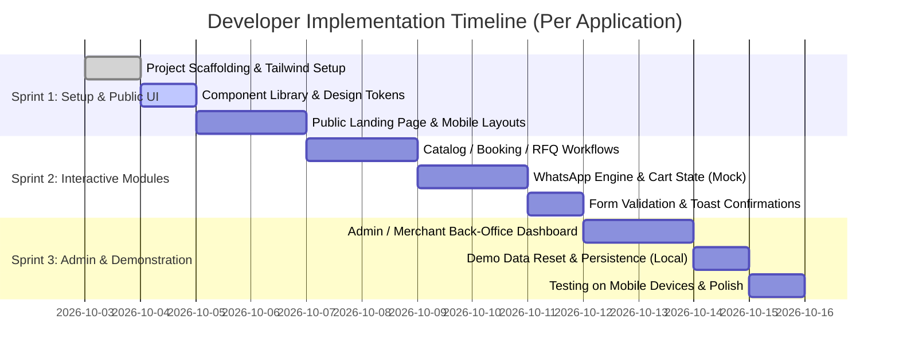

# Developer Specification & Engineering Blueprint
## Turn-Key Web Applications & Client Portals for Local Businesses

> **Target Audience**: Frontend & Full-Stack Developers, UI/UX Engineers.  
> **Purpose**: End-to-end technical specification to build, style, and demonstrate functional web applications for three commercial sectors (Healthcare Clinics, Retail Kirana Stores, and Modern Rice Mills).  
> **Crucial Requirement**: All applications must use **realistic dummy/mock data** to allow full demonstration of features (booking, carts, WhatsApp generation, RFQs, admin dashboards) without requiring live client data or external credentials.

---

## Table of Contents
1. [Core Development Philosophy & Rules](#1-core-development-philosophy--rules)
2. [Shared Technology Stack & Project Structure](#2-shared-technology-stack--project-structure)
3. [App 1: MediSync — Clinic Management & Patient Booking Portal](#3-app-1-medisync--clinic-management--patient-booking-portal)
   - [User Personas & Roles](#31-user-personas--roles)
   - [Page Sitemap & Wireframe Flow](#32-page-sitemap--wireframe-flow)
   - [Component & Feature Architecture](#33-component--feature-architecture)
   - [Database Schema (SQL DDL)](#34-database-schema-sql-ddl)
   - [REST API Endpoint Contract](#35-rest-api-endpoint-contract)
4. [App 2: KiranaKart — Hyperlocal Grocery & WhatsApp Storefront](#4-app-2-kiranakart--hyperlocal-grocery--whatsapp-storefront)
   - [User Personas & Roles](#41-user-personas--roles-kirana)
   - [Page Sitemap & Wireframe Flow](#42-page-sitemap--wireframe-flow-kirana)
   - [WhatsApp Message Generation Engine](#43-whatsapp-message-generation-engine)
   - [Database Schema (SQL DDL)](#44-database-schema-sql-ddl-kirana)
   - [Digital Khata (Customer Credit Ledger) Logic](#45-digital-khata-logic)
5. [App 3: AgroGrain — B2B Rice Mill & Wholesale Commodity Portal](#5-app-3-agrograin--b2b-rice-mill--wholesale-commodity-portal)
   - [User Personas & Roles](#51-user-personas--roles-agro)
   - [Page Sitemap & Wireframe Flow](#52-page-sitemap--wireframe-flow-agro)
   - [Live Mandi / Grain Rates Ticker Engine](#53-live-mandi-grain-rates-ticker-engine)
   - [Bulk RFQ (Request for Quote) Logic](#54-bulk-rfq-request-for-quote-logic)
   - [Database Schema (SQL DDL)](#55-database-schema-sql-ddl-agro)
6. [Ready-to-Use Dummy Data Fixtures (JSON)](#6-ready-to-use-dummy-data-fixtures-json)
7. [Step-by-Step Developer Implementation Roadmap](#7-step-by-step-developer-implementation-roadmap)

---

## 1. Core Development Philosophy & Rules

1. **Demo-Ready Interactivity**:
   - The user must be able to click buttons, fill out forms, add items to cart, filter categories, and see instant UI responses.
   - Any form submission (e.g., booking an appointment or placing an order) should trigger realistic feedback: toast notifications, modal confirmations, or URL redirection with mock query state.
2. **Strict Use of Realistic Dummy Data**:
   - **Do NOT** use real customer data or private patient information.
   - **Do NOT** use generic `Lorem Ipsum` or `Item 1`, `Item 2`. Use realistic local names, Indian currency (`₹`), genuine treatment names (e.g., *Root Canal Therapy, Laser Whitening*), authentic grocery items (e.g., *Sona Masoori Rice 25kg, Toor Dal 1kg*), and genuine rice milling specs (e.g., *Sortex Cleaned, 6.8mm grain length*).
3. **Zero External Backend Blockers**:
   - Implement data storage using **in-memory mock state** (React Context / Zustand / Pinia) initialized from JSON fixtures, optionally backed by `localStorage` so edits persist during client demonstrations.
4. **Mobile-First Responsive Layouts**:
   - Over 80% of local business owners and their customers access the web via smartphones. Ensure all layouts work seamlessly at `375px`, `768px`, and `1440px`.

---

## 2. Shared Technology Stack & Project Structure

### Recommended Stack
- **Framework**: Next.js 14+ (App Router) OR Vite + React 18+
- **Styling**: TailwindCSS (or modular Vanilla CSS) + Lucide React (for crisp UI icons)
- **State & Forms**: React Hook Form / Native Controlled State + Zustand or React Context
- **Date Handling**: `date-fns` (lightweight date manipulation for appointments and rates)

### Recommended Repository Folder Structure
```
my-local-apps/
├── src/
│   ├── components/
│   │   ├── common/              # Buttons, Badges, Modals, Toasts, Form Inputs
│   │   ├── clinic/              # Clinic booking wizard, Doctor cards, Slot picker
│   │   ├── kirana/              # Product cards, Cart drawer, Khata modal
│   │   └── agro/                # Live rate ticker, RFQ modal, Mill spec cards
│   ├── data/
│   │   ├── clinic-mock.json     # Mock doctors, services, booked appointments
│   │   ├── kirana-mock.json     # Mock catalog, categories, khata customers
│   │   └── agro-mock.json       # Mock rice varieties, daily rates, freight logs
│   ├── hooks/                   # useCart, useBooking, useKhata, useRates
│   ├── pages/ (or app/)         # Route pages (Home, Catalog, Admin, Checkout)
│   ├── types/                   # TypeScript interfaces / type definitions
│   └── utils/
│       ├── whatsapp.ts          # WhatsApp URL generator and text formatter
│       └── formatters.ts        # Currency (₹ INR), date, phone cleaners
├── public/                      # Mock product photos, doctor portraits, banners
└── package.json
```

---

## 3. App 1: MediSync — Clinic Management & Patient Booking Portal

### 3.1 User Personas & Roles
- **Patient (Public User)**: Finds the clinic via Google, browses doctors and treatments, selects a consultation time slot, and receives booking confirmation.
- **Receptionist / Front Desk (Staff)**: Views today's queue, checks in arriving patients, marks appointments as completed, or reschedules.
- **Doctor / Clinic Owner (Admin)**: Views daily patient count, manages working hours, sets consultation fees, and reviews basic patient notes.

### 3.2 Page Sitemap & Wireframe Flow
```
[Public Website]
  ├── / (Home: Hero, Clinic Bio, Doctor Showcase, Services, Map, Reviews)
  ├── /book (4-Step Appointment Booking Flow)
  └── /booking-success (Confirmation Screen with WhatsApp Calendar Sync)

[Staff / Doctor Portal]
  ├── /admin (Dashboard: Today's Appointments, Token Queue, Stats)
  ├── /admin/patients (Patient Directory & History Logs)
  └── /admin/schedule (Slot & Holiday Configuration)
```

### 3.3 Component & Feature Architecture

#### A. Interactive Booking Wizard (`/book`)
- **Step 1: Department & Service Selection**:
  - Filterable cards: *General Dentistry, Orthodontics, Cosmetic Whitening, Dental Implants, Pediatric Care*.
  - Displays service duration (e.g. *30 mins*) and consultation fee (`₹400 - ₹800`).
- **Step 2: Doctor Selection**:
  - Doctor card with photo, qualification (e.g., *MDS - Orthodontics*), experience (*12+ Years*), and next available slot badge.
- **Step 3: Date & Slot Picker**:
  - Interactive mini-calendar (next 14 days).
  - Slot buckets: **Morning** (09:30 AM – 01:00 PM) and **Evening** (05:00 PM – 09:00 PM).
  - Disabled slots for already booked mock appointments.
- **Step 4: Patient Particulars**:
  - Fields: Full Name, Mobile Number, Age, Gender, Existing Patient? (Yes/No), Chief Complaint / Symptoms.
- **Confirmation State**:
  - Generates a unique Token ID (e.g., `MED-8492`).
  - Renders a **"Send Confirmation to WhatsApp"** button which opens WhatsApp with pre-filled message text:
    ```
    "Hello Dr. Preeti, I have booked an appointment for Dental Consultation on Friday, 10:30 AM. Token ID: MED-8492. Name: Rajesh Kumar."
    ```

#### B. Doctor Admin Dashboard (`/admin`)
- **Top Metric Cards**:
  - *Today's Appointments* (e.g. `18 Scheduled`)
  - *Checked-In Patients* (e.g. `6 Waiting`)
  - *Completed Consultations* (e.g. `9 Finished`)
  - *No-Show / Cancelled* (e.g. `3`)
- **Live Token Queue Table**:
  - Columns: Token #, Patient Name, Age, Service, Time Slot, Status (`Scheduled` [Blue], `In-Consultation` [Amber], `Completed` [Green], `Cancelled` [Red]).
  - Actions: 1-Click "Mark as In-Consultation", "Mark Completed", "Send WhatsApp Reminder".

### 3.4 Database Schema (SQL DDL)
```sql
-- Clinics & Branches
CREATE TABLE clinics (
    clinic_id VARCHAR(36) PRIMARY KEY,
    name VARCHAR(255) NOT NULL,
    city VARCHAR(100) NOT NULL,
    address TEXT NOT NULL,
    phone VARCHAR(20) NOT NULL,
    email VARCHAR(150),
    google_maps_url TEXT
);

-- Doctors / Practitioners
CREATE TABLE doctors (
    doctor_id VARCHAR(36) PRIMARY KEY,
    clinic_id VARCHAR(36) REFERENCES clinics(clinic_id),
    full_name VARCHAR(150) NOT NULL,
    specialization VARCHAR(100) NOT NULL,
    qualification VARCHAR(100) NOT NULL,
    experience_years INT DEFAULT 5,
    consultation_fee DECIMAL(10,2) NOT NULL,
    avatar_url TEXT
);

-- Services Offered
CREATE TABLE services (
    service_id VARCHAR(36) PRIMARY KEY,
    doctor_id VARCHAR(36) REFERENCES doctors(doctor_id),
    service_name VARCHAR(150) NOT NULL,
    category VARCHAR(100) NOT NULL,
    duration_minutes INT DEFAULT 30,
    price_inr DECIMAL(10,2) NOT NULL
);

-- Appointments
CREATE TABLE appointments (
    appointment_id VARCHAR(36) PRIMARY KEY,
    token_number VARCHAR(20) UNIQUE NOT NULL,
    doctor_id VARCHAR(36) REFERENCES doctors(doctor_id),
    service_id VARCHAR(36) REFERENCES services(service_id),
    patient_name VARCHAR(150) NOT NULL,
    patient_phone VARCHAR(20) NOT NULL,
    patient_age INT,
    patient_gender VARCHAR(10),
    appointment_date DATE NOT NULL,
    slot_time VARCHAR(20) NOT NULL,
    status VARCHAR(20) DEFAULT 'SCHEDULED', -- SCHEDULED, IN_PROGRESS, COMPLETED, CANCELLED
    notes TEXT,
    created_at TIMESTAMP DEFAULT CURRENT_TIMESTAMP
);
```

### 3.5 REST API Endpoint Contract (For Mock API or Future Backend)
- `GET /api/clinic/doctors`: Returns list of doctors and qualifications.
- `GET /api/clinic/services?doctorId={id}`: Returns services and fees.
- `GET /api/clinic/available-slots?doctorId={id}&date={YYYY-MM-DD}`: Returns list of time strings and availability boolean.
- `POST /api/clinic/appointments`: Submits patient booking, returns token and confirmation payload.
- `GET /api/clinic/admin/appointments?date={today}`: Returns queue for admin dashboard.
- `PATCH /api/clinic/admin/appointments/{id}/status`: Updates status (`IN_PROGRESS`, `COMPLETED`).

---

## 4. App 2: KiranaKart — Hyperlocal Grocery & WhatsApp Storefront

### 4.1 User Personas & Roles (Kirana)
- **Local Resident / Shopper (Customer)**: Browses grocery inventory on phone, adds staples to cart, selects home delivery or self-pickup, sends order via WhatsApp.
- **Kirana Merchant / Store Owner**: Updates daily commodity prices (oil, rice, dal), receives orders on WhatsApp, and manages customer credit balances on the Digital Khata.

### 4.2 Page Sitemap & Wireframe Flow (Kirana)
```
[Customer PWA Storefront]
  ├── / (Store Banner, Quick Categories, Trending Deals, Search Bar)
  ├── /category/:slug (Category Catalog: Grains, Oils, Dairy, Spices)
  ├── /cart (Floating Drawer / Page with Order Summary & Delivery Details)
  └── /order-placed (Summary screen + "Launch WhatsApp Order")

[Merchant Back-Office]
  ├── /merchant/products (Instant In-Stock/Out-of-Stock & Price Editor)
  ├── /merchant/khata (Digital Customer Credit Ledger & Balance SMS trigger)
  └── /merchant/orders (Recent Orders Log)
```

### 4.3 WhatsApp Message Generation Engine
In local Indian retail, **WhatsApp is the checkout terminal**. Instead of forcing users to enter payment cards on an unfamiliar website, the application generates a pre-formatted, easy-to-read order text and deep-links to WhatsApp:

#### Logic Specification (`utils/whatsapp.ts`)
```typescript
interface CartItem {
  name: string;
  unit: string;
  qty: number;
  price: number;
}

export function generateWhatsAppOrderUrl(
  storePhone: string,
  storeName: string,
  customerName: string,
  customerAddress: string,
  deliveryType: 'Home Delivery' | 'Store Pickup',
  items: CartItem[]
): string {
  const total = items.reduce((acc, item) => acc + item.price * item.qty, 0);
  
  let msg = `🛒 *NEW ORDER - ${storeName.toUpperCase()}*\n`;
  msg += `─────────────────────────\n`;
  msg += `👤 *Customer*: ${customerName}\n`;
  msg += `🚚 *Delivery*: ${deliveryType}\n`;
  if (deliveryType === 'Home Delivery') {
    msg += `📍 *Address*: ${customerAddress}\n`;
  }
  msg += `─────────────────────────\n`;
  msg += `*ORDERED ITEMS*:\n`;
  
  items.forEach((item, idx) => {
    const itemTotal = item.price * item.qty;
    msg += `${idx + 1}. ${item.name} (${item.unit}) x ${item.qty} = ₹${itemTotal}\n`;
  });
  
  msg += `─────────────────────────\n`;
  msg += `💰 *TOTAL AMOUNT*: *₹${total}*\n`;
  msg += `💵 *Payment Mode*: Cash on Delivery / UPI on Delivery\n`;
  msg += `─────────────────────────\n`;
  msg += `Please confirm my order and share delivery timing. Thank you!`;

  return `https://wa.me/${storePhone.replace(/[^0-9]/g, '')}?text=${encodeURIComponent(msg)}`;
}
```

### 4.4 Database Schema (SQL DDL - Kirana)
```sql
-- Store Profile
CREATE TABLE stores (
    store_id VARCHAR(36) PRIMARY KEY,
    store_name VARCHAR(255) NOT NULL,
    owner_name VARCHAR(150) NOT NULL,
    whatsapp_number VARCHAR(20) NOT NULL,
    address TEXT NOT NULL,
    city VARCHAR(100) NOT NULL,
    min_order_amount DECIMAL(10,2) DEFAULT 200.00,
    delivery_radius_km DECIMAL(4,1) DEFAULT 3.5
);

-- Product Catalog
CREATE TABLE products (
    product_id VARCHAR(36) PRIMARY KEY,
    store_id VARCHAR(36) REFERENCES stores(store_id),
    category VARCHAR(100) NOT NULL, -- Rice & Grains, Dal & Pulses, Oils & Ghee, Masalas, Snacks
    name VARCHAR(200) NOT NULL,
    unit VARCHAR(50) NOT NULL, -- 1 kg, 5 kg, 25 kg bag, 1 Litre, 500 ml
    price_inr DECIMAL(10,2) NOT NULL,
    mrp_inr DECIMAL(10,2),
    is_in_stock BOOLEAN DEFAULT TRUE,
    image_url TEXT
);

-- Khata Customers (Credit Ledger)
CREATE TABLE khata_customers (
    customer_id VARCHAR(36) PRIMARY KEY,
    store_id VARCHAR(36) REFERENCES stores(store_id),
    name VARCHAR(150) NOT NULL,
    phone VARCHAR(20) NOT NULL,
    address TEXT,
    current_balance_due DECIMAL(10,2) DEFAULT 0.00,
    last_payment_date DATE
);

-- Khata Ledger Transactions
CREATE TABLE khata_transactions (
    txn_id VARCHAR(36) PRIMARY KEY,
    customer_id VARCHAR(36) REFERENCES khata_customers(customer_id),
    txn_type VARCHAR(10) NOT NULL, -- 'CREDIT' (Goods Taken) or 'PAYMENT' (Money Paid)
    amount DECIMAL(10,2) NOT NULL,
    description TEXT,
    created_at TIMESTAMP DEFAULT CURRENT_TIMESTAMP
);
```

### 4.5 Digital Khata (Customer Credit Ledger) Logic
- **Merchant Khata View (`/merchant/khata`)**:
  - Displays total outstanding market credit across all neighborhood customers (e.g. `₹48,250 Total Due`).
  - Searchable list of frequent customers.
  - Color-coded badges: Due > 30 days (*Red Alert*), Due < 15 days (*Amber*), Fully Paid (*Green*).
  - **"Send WhatsApp Payment Reminder"** button generates:
    ```
    "Namaste Rajesh garu, this is Sri Lakshmi Kirana Stores. Your pending store balance is ₹1,450 as of today. You can pay via PhonePe/GooglePay to 9440112380. Thank you!"
    ```
  - **"Record Payment"** modal: input amount, select mode (UPI / Cash), updates balance instantly.

---

## 5. App 3: AgroGrain — B2B Rice Mill & Wholesale Commodity Portal

### 5.1 User Personas & Roles (Agro)
- **Wholesale Commodity Buyer / Trader**: Grain wholesaler from Hyderabad, Chennai, or Bangalore looking for verified rice millers, checking live mandi rates, and submitting bulk truckload inquiries.
- **Rice Mill Managing Partner / Dispatcher**: Mill owner updating daily pricing per bag/quintal, evaluating inbound bulk RFQs, and generating lorry transport dispatch slips.

### 5.2 Page Sitemap & Wireframe Flow (Agro)
```
[Public B2B Portal]
  ├── / (Live Mandi Ticker, Mill Credentials, Sortex Tech Showcase, Varieties)
  ├── /varieties (Wholesale Specifications: Moisture, Grain Length, Broken %)
  ├── /rfq (Bulk Request for Quote Generator & Shipping Cost Estimator)
  └── /certifications (FSSAI, ISO, APEDA, Lab Test Reports)

[Miller Operations Portal]
  ├── /portal/rates (Live Daily Price Controller with 1-Click Update)
  ├── /portal/rfq-inbox (Wholesale Inquiries, Quotation Generator)
  └── /portal/dispatch (Truck Dispatch & Lorry Bilty Generator)
```

### 5.3 Live Mandi / Grain Rates Ticker Engine
Modern rice pricing fluctuates daily based on paddy arrivals at local market yards. The portal features a sticky, real-time ticker bar:
- **Display Fields**: Rice Variety, Processing Type (Raw, Steam, Boiled), Daily Rate (₹ per Quintal / ₹ per 25kg bag), 24h Change (e.g. `+₹50 ▲` or `-₹20 ▼`), Last Updated Timestamp.
- **Quick Update Widget for Miller**: A simple slider or numeric input allowing the owner to update today's wholesale price in under 10 seconds.

### 5.4 Bulk RFQ (Request for Quote) Logic
Wholesale buyers do not buy single items via a credit card; they buy in **Metric Tons (MT)**:
- **Input Form**:
  1. *Rice Grade*: Sona Masoori Raw / Steam, BPT 5204, 1061 Swarna, Broken Rice, Rice Bran.
  2. *Quantity Needed*: 5 MT, 10 MT, 20 MT (Full Truck Load - FTL), 50+ MT.
  3. *Packaging Spec*: 25 kg Branded Bopp Bag, 50 kg Non-woven Bag, 50 kg Jute Bag, Plain White.
  4. *Destination City*: Hyderabad, Bangalore, Chennai, Vijayawada, Vizag, Mumbai, Export Port.
  5. *Buyer Information*: Business Name, GST Number (optional/mock), Contact Person, Phone, Email.
- **Interactive Price Estimator**:
  - Dynamically calculates:
    $$\text{Estimated Subtotal} = \text{Quantity (MT)} \times \text{Live Price/MT}$$
    $$\text{Packaging Cost} = \text{Bag Quantity} \times \text{Bag Price}$$
    $$\text{Estimated Total Cost (Ex-Mill)} = \text{Subtotal} + \text{Packaging}$$
  - Generates official quotation PDF preview and notifies miller.

### 5.5 Database Schema (SQL DDL - Agro)
```sql
-- Modern Rice Mill Profile
CREATE TABLE rice_mills (
    mill_id VARCHAR(36) PRIMARY KEY,
    mill_name VARCHAR(255) NOT NULL,
    managing_partner VARCHAR(150) NOT NULL,
    phone VARCHAR(20) NOT NULL,
    email VARCHAR(150),
    milling_capacity_tpd INT DEFAULT 100, -- Tons Per Day
    sortex_technology VARCHAR(100) DEFAULT 'Buhler 5-Chute Optical Sorter',
    district VARCHAR(100) NOT NULL,
    gps_coordinates VARCHAR(50)
);

-- Commodity Varieties & Live Rates
CREATE TABLE grain_varieties (
    variety_id VARCHAR(36) PRIMARY KEY,
    mill_id VARCHAR(36) REFERENCES rice_mills(mill_id),
    name VARCHAR(150) NOT NULL, -- Sona Masoori (Raw), Sona Masoori (Steam), Broken Rice (100% sortex)
    grain_length_mm DECIMAL(3,1), -- e.g. 5.2 mm
    moisture_percentage DECIMAL(3,1), -- e.g. 12.5%
    broken_percentage DECIMAL(3,1), -- e.g. 2.0%
    price_per_quintal DECIMAL(10,2) NOT NULL, -- 100 kg
    price_per_25kg_bag DECIMAL(10,2) NOT NULL,
    price_trend_24h VARCHAR(10) DEFAULT '+0', -- '+50', '-20'
    last_updated TIMESTAMP DEFAULT CURRENT_TIMESTAMP
);

-- Bulk RFQs (Wholesale Inquiries)
CREATE TABLE bulk_rfqs (
    rfq_id VARCHAR(36) PRIMARY KEY,
    mill_id VARCHAR(36) REFERENCES rice_mills(mill_id),
    variety_id VARCHAR(36) REFERENCES grain_varieties(variety_id),
    buyer_company VARCHAR(200) NOT NULL,
    buyer_contact_person VARCHAR(150) NOT NULL,
    buyer_phone VARCHAR(20) NOT NULL,
    destination_city VARCHAR(100) NOT NULL,
    quantity_metric_tons DECIMAL(6,2) NOT NULL,
    packaging_type VARCHAR(50) NOT NULL, -- 25kg BOPP, 50kg Jute, 50kg PP
    estimated_amount_inr DECIMAL(12,2),
    status VARCHAR(20) DEFAULT 'PENDING_REVIEW', -- PENDING_REVIEW, QUOTE_SENT, ACCEPTED, REJECTED
    created_at TIMESTAMP DEFAULT CURRENT_TIMESTAMP
);

-- Freight & Dispatch Logs
CREATE TABLE dispatch_logs (
    dispatch_id VARCHAR(36) PRIMARY KEY,
    rfq_id VARCHAR(36) REFERENCES bulk_rfqs(rfq_id),
    truck_number VARCHAR(20) NOT NULL, -- e.g. AP 04 TX 9821
    driver_name VARCHAR(150) NOT NULL,
    driver_phone VARCHAR(20) NOT NULL,
    gross_weight_mt DECIMAL(6,2),
    tare_weight_mt DECIMAL(6,2),
    net_weight_mt DECIMAL(6,2),
    dispatch_date DATE NOT NULL,
    status VARCHAR(20) DEFAULT 'IN_TRANSIT'
);
```

---

## 6. Ready-to-Use Dummy Data Fixtures (JSON)

Developers can copy these exact JSON fixtures into their projects to power their mock frontends immediately.

### Fixture A: Clinic Mock Data (`src/data/clinic-mock.json`)
```json
{
  "clinic": {
    "name": "Suma Dental Specialities & Implant Centre",
    "doctor": "Dr. P. Suma Latha, MDS",
    "designation": "Chief Dental Surgeon & Implantologist",
    "phone": "+91 866 2434510",
    "email": "sumadental.vja@gmail.com",
    "city": "Vijayawada",
    "district": "NTR District, Andhra Pradesh",
    "address": "40-1-52, MG Road, Near Benz Circle, Vijayawada - 520010",
    "google_rating": 4.9,
    "review_count": 342,
    "timing": "Mon - Sat: 9:30 AM - 1:30 PM & 5:00 PM - 9:00 PM"
  },
  "services": [
    {
      "id": "srv-01",
      "name": "Digital Smile Designing & Whitening",
      "category": "Cosmetic",
      "duration": "45 mins",
      "price": 3500,
      "description": "Advanced LED teeth whitening removing years of stains in a single session."
    },
    {
      "id": "srv-02",
      "name": "Single Sitting Root Canal (RCT)",
      "category": "Endodontics",
      "duration": "60 mins",
      "price": 2800,
      "description": "Painless computer-guided root canal treatment using rotary instruments."
    },
    {
      "id": "srv-03",
      "name": "Titanium Dental Implant",
      "category": "Implantology",
      "duration": "60 mins",
      "price": 18000,
      "description": "Lifetime guaranteed European grade titanium implants with zirconia crown."
    },
    {
      "id": "srv-04",
      "name": "Invisible Clear Aligners",
      "category": "Orthodontics",
      "duration": "30 mins",
      "price": 45000,
      "description": "Custom 3D transparent trays to straighten teeth without metal braces."
    },
    {
      "id": "srv-05",
      "name": "Comprehensive Dental Consultation",
      "category": "General",
      "duration": "20 mins",
      "price": 400,
      "description": "Full oral cavity checkup, digital X-rays, and customized treatment plan."
    }
  ],
  "mock_slots": [
    "09:30 AM", "10:00 AM", "10:30 AM", "11:00 AM", "11:30 AM", "12:00 PM",
    "05:00 PM", "05:30 PM", "06:00 PM", "06:30 PM", "07:00 PM", "07:30 PM", "08:00 PM"
  ],
  "existing_appointments": [
    {
      "token": "MED-101",
      "patient_name": "Srinivasa Rao K.",
      "phone": "+91 98480 34202",
      "service": "Comprehensive Dental Consultation",
      "slot": "09:30 AM",
      "status": "COMPLETED"
    },
    {
      "token": "MED-102",
      "patient_name": "Lakshmi Prasanna",
      "phone": "+91 94401 23101",
      "service": "Single Sitting Root Canal (RCT)",
      "slot": "10:00 AM",
      "status": "IN_PROGRESS"
    },
    {
      "token": "MED-103",
      "patient_name": "Kiran Kumar Varma",
      "phone": "+91 8816 224110",
      "service": "Digital Smile Designing & Whitening",
      "slot": "11:30 AM",
      "status": "SCHEDULED"
    }
  ]
}
```

---

### Fixture B: Kirana Store Mock Data (`src/data/kirana-mock.json`)
```json
{
  "store": {
    "name": "Sri Lakshmi Kirana & General Stores",
    "owner": "G. Lakshmi Narayana",
    "whatsapp_phone": "919440123101",
    "city": "Machilipatnam",
    "district": "Krishna District",
    "delivery_note": "Free Home Delivery within 3 km on orders above ₹300",
    "upi_id": "9440123101@ybl"
  },
  "categories": ["All", "Rice & Grains", "Dals & Pulses", "Edible Oils", "Spices & Masalas", "Daily Essentials"],
  "products": [
    {
      "id": "prod-1",
      "name": "Kurnool Sona Masoori Rice (Old Harvest)",
      "category": "Rice & Grains",
      "unit": "25 kg Bag",
      "price": 1450,
      "mrp": 1600,
      "in_stock": true,
      "image": "https://images.unsplash.com/photo-1586201375761-83865001e31c?w=400"
    },
    {
      "id": "prod-2",
      "name": "Premium Guntur Teja Red Chilli Powder",
      "category": "Spices & Masalas",
      "unit": "500 g",
      "price": 190,
      "mrp": 220,
      "in_stock": true,
      "image": "https://images.unsplash.com/photo-1596040033229-a9821ebd058d?w=400"
    },
    {
      "id": "prod-3",
      "name": "Freedom Refined Sunflower Oil",
      "category": "Edible Oils",
      "unit": "1 Litre Pouch",
      "price": 125,
      "mrp": 140,
      "in_stock": true,
      "image": "https://images.unsplash.com/photo-1474979266404-7eaacbcd87c5?w=400"
    },
    {
      "id": "prod-4",
      "name": "Unpolished Desi Toor Dal (Kandi Pappu)",
      "category": "Dals & Pulses",
      "unit": "1 kg",
      "price": 165,
      "mrp": 185,
      "in_stock": true,
      "image": "https://images.unsplash.com/photo-1546069901-ba9599a7e63c?w=400"
    },
    {
      "id": "prod-5",
      "name": "Aashirvaad Shudh Chakki Atta",
      "category": "Rice & Grains",
      "unit": "5 kg Bag",
      "price": 260,
      "mrp": 290,
      "in_stock": true,
      "image": "https://images.unsplash.com/photo-1509440159596-0249088772ff?w=400"
    },
    {
      "id": "prod-6",
      "name": "Pure Vijaya Cow Ghee",
      "category": "Edible Oils",
      "unit": "500 ml Tin",
      "price": 380,
      "mrp": 410,
      "in_stock": true,
      "image": "https://images.unsplash.com/photo-1589927986089-35812388d1f4?w=400"
    }
  ],
  "khata_customers": [
    {
      "id": "kht-01",
      "name": "V. Kameswara Rao",
      "phone": "+91 94404 89787",
      "balance_due": 1850,
      "last_payment_date": "2026-09-18",
      "days_overdue": 14
    },
    {
      "id": "kht-02",
      "name": "M. Anjaneya Prasad",
      "phone": "+91 98480 78676",
      "balance_due": 620,
      "last_payment_date": "2026-09-28",
      "days_overdue": 4
    },
    {
      "id": "kht-03",
      "name": "R. Sitaramaiah",
      "phone": "+91 94407 34232",
      "balance_due": 4200,
      "last_payment_date": "2026-08-30",
      "days_overdue": 33
    }
  ]
}
```

---

### Fixture C: Rice Mill Mock Data (`src/data/agro-mock.json`)
```json
{
  "mill": {
    "name": "Sri Balaji Modern Rice Mill",
    "managing_partner": "B. Balaji Subbaiah",
    "phone": "+91 98480 33202",
    "email": "balajiricemill.kdp@gmail.com",
    "city": "Kadapa",
    "district": "Kadapa (YSR Kadapa)",
    "daily_capacity": "150 Metric Tons/Day",
    "sorter": "Buhler 5-Chute Trichromatic Color Sorter",
    "certifications": ["FSSAI License #10118023000412", "ISO 22000:2018", "APEDA Certified Exporter"],
    "silo_capacity": "5,000 Metric Tons Storage"
  },
  "grain_rates": [
    {
      "id": "grn-1",
      "name": "Sona Masoori Raw Rice (Super Fine)",
      "grain_length": "5.4 mm",
      "moisture": "12.0%",
      "broken_percentage": "1.5%",
      "price_per_quintal": 4200,
      "price_per_25kg": 1050,
      "trend_24h": "+50",
      "in_stock_tonnage": 450
    },
    {
      "id": "grn-2",
      "name": "Sona Masoori Steam Rice (Standard)",
      "grain_length": "5.3 mm",
      "moisture": "12.5%",
      "broken_percentage": "2.0%",
      "price_per_quintal": 3950,
      "price_per_25kg": 990,
      "trend_24h": "-20",
      "in_stock_tonnage": 800
    },
    {
      "id": "grn-3",
      "name": "Swarna 1061 Boiled / Parboiled Rice",
      "grain_length": "5.0 mm",
      "moisture": "13.0%",
      "broken_percentage": "3.0%",
      "price_per_quintal": 3200,
      "price_per_25kg": 800,
      "trend_24h": "0",
      "in_stock_tonnage": 1200
    },
    {
      "id": "grn-4",
      "name": "100% Sortex Broken Rice (Nookalu)",
      "grain_length": "2.5 mm",
      "moisture": "11.5%",
      "broken_percentage": "100%",
      "price_per_quintal": 2450,
      "price_per_25kg": 612,
      "trend_24h": "+30",
      "in_stock_tonnage": 250
    },
    {
      "id": "grn-5",
      "name": "De-oiled Rice Bran (DORB) - 16% Protein",
      "grain_length": "Powder",
      "moisture": "10.0%",
      "broken_percentage": "N/A",
      "price_per_quintal": 2100,
      "price_per_25kg": 525,
      "trend_24h": "+40",
      "in_stock_tonnage": 600
    }
  ],
  "recent_rfqs": [
    {
      "rfq_number": "RFQ-9021",
      "buyer_company": "Sri Sai Srinivasa Wholesale Traders",
      "contact_person": "P. Srinivasa Reddy",
      "destination": "Hyderabad, Telangana",
      "variety": "Sona Masoori Raw Rice",
      "quantity_mt": 25.0,
      "packaging": "25kg BOPP Branded Bag",
      "estimated_total_inr": 1050000,
      "status": "QUOTED"
    },
    {
      "rfq_number": "RFQ-9022",
      "buyer_company": "Annapurna Food Corporation",
      "contact_person": "M. Venkatramana",
      "destination": "Chennai Port, Tamil Nadu",
      "variety": "Sona Masoori Steam Rice",
      "quantity_mt": 50.0,
      "packaging": "50kg Jute Export Bag",
      "estimated_total_inr": 1975000,
      "status": "PENDING"
    }
  ]
}
```

---

## 7. Step-by-Step Developer Implementation Roadmap

Developers should execute each application in **3 focused sprints**:



### Sprint Checklist:

#### Day 1–2: Scaffolding & Design Foundation
- [ ] Initialize repository with Next.js or Vite React.
- [ ] Copy the mock JSON fixtures into `/src/data/`.
- [ ] Configure Tailwind theme colors:
  - Healthcare: Teal & Clean Slate (`#008080`, `#0F172A`)
  - Kirana: Fresh Emerald & Warm Amber (`#16A34A`, `#F59E0B`)
  - Agro: Royal Navy & Harvest Gold (`#1E3A8A`, `#D97706`)

#### Day 3–5: Core Public Interactive Flows
- [ ] **MediSync**: Implement the 4-step appointment booking wizard with slot disablement.
- [ ] **KiranaKart**: Build category filter pills, sticky cart badge, and instant quantity updater.
- [ ] **AgroGrain**: Build sticky live rate ticker and bulk metric-ton price calculator.

#### Day 6–7: WhatsApp & Communication Triggers
- [ ] Implement `generateWhatsAppOrderUrl` and `generateWhatsAppBookingUrl`.
- [ ] Ensure clicking buttons on mobile opens WhatsApp immediately; on desktop, opens `web.whatsapp.com`.

#### Day 8–10: Admin Back-Office Portals
- [ ] **MediSync Admin**: Implement token status toggle (`Scheduled` ➔ `In-Consultation` ➔ `Completed`).
- [ ] **Kirana Khata**: Build credit ledger with "Send WhatsApp Payment Reminder" button.
- [ ] **Agro Rate Controller**: Build simple price editor updating the live ticker in real time.

---

## 8. Summary of Developer Deliverables

By following this specification, the development team can produce **three fully interactive, state-of-the-art prototype applications** without waiting for live databases or external APIs. 

When pitching to real clinic doctors, kirana merchants, or rice millers, the team simply opens the corresponding prototype on a smartphone, types in a dummy customer name, taps **"Send to WhatsApp"**, and demonstrates the exact business growth software their business will receive.
